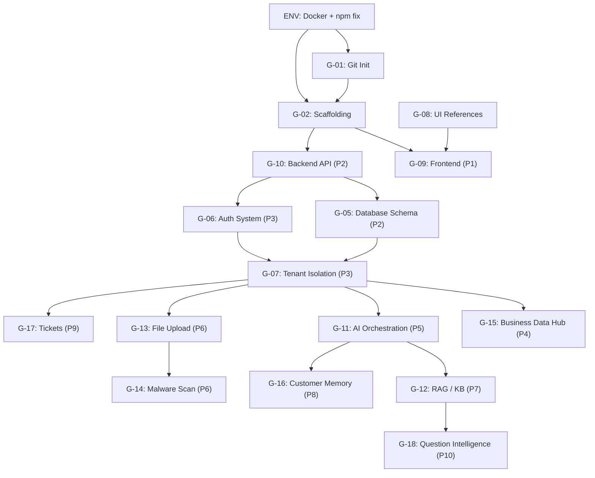

# GAPS AND RISKS — BankingAIPlatform

**Date:** 2026-11-24  
**Status:** Greenfield Assessment (Full Master Specification)

---

## 1. Gap Analysis Summary

This is a greenfield project — every target capability is a gap. This document focuses on **prioritization, dependencies, critical path, and risk** rather than restating universal absence.

---

## 2. Critical-Path Gaps (Block All Downstream Work)

| # | Gap | Dependency Chain | Phase | Risk if Deferred |
|---|---|---|---|---|
| G-01 | **No version control** | Blocks collaboration, rollback, CI/CD | P0→P1 | Code loss, no audit trail |
| G-02 | **No project scaffolding** | Blocks all development | P1 | Cannot begin any implementation |
| G-03 | **Docker not installed** | Blocks dev environment (PG, Redis, Keycloak, MinIO) | P1 | Cannot run any infrastructure locally |
| G-04 | **npm execution policy blocked** | Blocks frontend dev server and dependency install | P1 | Cannot build frontend |
| G-05 | **No database schema** | Blocks all data persistence | P2 | No conversations, users, tenants |
| G-06 | **No authentication system** | Blocks all protected functionality | P3 | Insecure access to everything |
| G-07 | **No tenant isolation** | Blocks multi-tenancy | P3 | Cross-tenant data leakage |
| G-08 | **No UI reference images** | Blocks approved visual design implementation | P1 | Cannot implement UI per spec §11 |

## 3. High-Priority Gaps (Required for Core Product)

| # | Gap | Impact | Phase |
|---|---|---|---|
| G-09 | No frontend application | No user interface | P1 |
| G-10 | No backend API | No server-side functionality | P2 |
| G-11 | No AI orchestration or agents | No intelligent responses (core value prop) | P5 |
| G-12 | No RAG / knowledge base | Agents cannot access business knowledge | P7 |
| G-13 | No file upload pipeline | Customers cannot share documents | P6 |
| G-14 | No malware scanning | Uploaded files pose security risk | P6 |
| G-15 | No Business Data Hub | No data source integration | P4 |
| G-16 | No customer memory system | No personalized context across interactions | P8 |
| G-17 | No ticket/complaint lifecycle | No structured issue management | P9 |
| G-18 | No monitoring/logging | Blind to production issues | P2+ |
| G-19 | No CI/CD pipeline | Manual, error-prone deployment | P2+ |

## 4. Environment Gaps

| # | Gap | Current State | Required State | Resolution |
|---|---|---|---|---|
| ENV-01 | Docker not installed | `docker` command not found | Docker Desktop or Docker Engine | User must install before Phase 1 |
| ENV-02 | npm execution policy | PowerShell blocks npm.ps1 | `Set-ExecutionPolicy` or use CMD | User must resolve before Phase 1 |
| ENV-03 | No PostgreSQL | Not installed or running | Via Docker Compose | Depends on ENV-01 |
| ENV-04 | No Redis | Not installed or running | Via Docker Compose | Depends on ENV-01 |
| ENV-05 | No Keycloak | Not installed or running | Via Docker Compose | Depends on ENV-01 |

---

## 5. Risk Register

### 5.1 Technical Risks

| ID | Risk | L | I | Mitigation |
|---|---|---|---|---|
| R-01 | Scope creep — 16 phases, 10 modules, 100+ features | High | High | Strict phase scope control, approval gates |
| R-02 | AI orchestration complexity — 7 agent types | Medium | High | Start simple (single agent), iterate |
| R-03 | Multi-tenancy isolation failure | Medium | Critical | RLS + app-level guards + integration tests from Phase 2 |
| R-04 | LLM provider API instability or cost | Medium | Medium | Provider abstraction, fallback, token budgets |
| R-05 | pgvector scaling limits at high document volume | Low | Medium | Monitor latency, plan dedicated vector DB migration |
| R-06 | Celery task reliability / dead letter accumulation | Medium | Medium | Idempotent tasks, DLQ monitoring, retries |
| R-07 | Google Sheets API rate limits | Medium | Low | Backoff, caching, sync scheduling |
| R-08 | ClamAV container resource usage | Low | Low | Resource limits, async scanning queue |
| R-09 | Environment blocker (Docker not installed) | High | High | Must resolve before Phase 1 implementation |

### 5.2 Security Risks (from §7)

| ID | Risk | L | I | Phase to Mitigate |
|---|---|---|---|---|
| S-01 | Prompt injection via chat input | High | High | P5 |
| S-02 | Indirect prompt injection via uploaded documents/images | High | High | P6 |
| S-03 | Malicious file upload (malware, polyglots, zip bombs) | High | Critical | P6 |
| S-04 | Cross-tenant data leakage | Medium | Critical | P3 |
| S-05 | RAG/knowledge base poisoning | Medium | High | P7 |
| S-06 | Customer memory poisoning | Medium | High | P8 |
| S-07 | Unauthorized tool execution | Medium | High | P12 |
| S-08 | MCP output poisoning | Medium | High | P12 |
| S-09 | Secrets exposure in code/logs | Medium | Critical | P1+ |
| S-10 | Broken authentication bypass | Low | Critical | P3 |
| S-11 | Insecure file storage (public access, IDOR) | Medium | High | P6 |
| S-12 | API abuse / rate limiting bypass | Medium | Medium | P2+ |
| S-13 | LLM data exfiltration via crafted prompts | Medium | High | P5 |

### 5.3 Operational Risks

| ID | Risk | L | I | Mitigation |
|---|---|---|---|---|
| O-01 | No rollback capability | High (initially) | High | Git + Docker image tags from Phase 1 |
| O-02 | Environment drift between dev/staging/prod | Medium | Medium | Docker Compose parity, env validation |
| O-03 | Dependency supply chain attack | Low | High | Lock files, Trivy, SBOM (Syft) |
| O-04 | No backup/recovery | High (initially) | Critical | Phase 15, but basic PG backup from Phase 2 |
| O-05 | Cloud cost overrun | Medium | Medium | No cloud resources without approval, cost monitoring |

---

## 6. Dependency Map

---

## 7. Resolution Priority

| Priority | Items | Action |
|---|---|---|
| **Immediate** (before Phase 1) | ENV-01 (Docker), ENV-02 (npm), G-08 (UI references) | User action required |
| **Phase 1** | G-01 (git), G-02 (scaffold), G-09 (frontend) | First implementation tasks |
| **Phase 2** | G-10 (API), G-05 (DB), G-18 (monitoring) | Core platform |
| **Phase 3** | G-06 (auth), G-07 (tenant isolation) | Security foundation |
| **Phase 4** | G-15 (Business Data Hub) | Business configuration |
| **Phase 5** | G-11 (AI orchestration) | Core value proposition |
| **Phase 6** | G-13 (upload), G-14 (malware scan) | Document intelligence |
| **Phase 7** | G-12 (RAG/KB) | Knowledge management |
| **Phase 8+** | G-16, G-17, remaining features | Full platform buildout |

---

## 6. Post-Hardening Remaining Gaps & Ranked Risks (2026-11-25)

| Rank | ID | Risk / Gap | Current Status | Required Action |
|---|---|---|---|---|
| 1 (Critical) | GAP-H01 | **Live PostgreSQL 16 RLS execution** | `NOT VERIFIED` locally (`psql`/`docker` missing); migration `013` & CI job ready | Run `uv run pytest tests/test_rls_postgres_integration.py` against PG 16 (`POSTGRES_TEST_URL`) with non-superuser role |
| 2 (Critical) | GAP-H02 | **Keycloak OIDC JWKS validation** | `NOT VERIFIED` (`ALLOW_DEV_STATIC_JWT_SECRET` fails prod startup; live JWKS fetch not wired) | Connect live Keycloak realm RS256 JWKS verification in `security.py` and PKCE login in frontend |
| 3 (High) | GAP-H03 | **Frontend module pages render demo data** | `PARTIALLY VERIFIED` (`apiClient.ts` + `Demo Data` banner wired; 9 pages not yet wired) | Wire `frontend/src/pages/*.tsx` to `/api/v1/*` endpoints |
| 4 (High) | GAP-H04 | **Host-missing security & a11y scanners** | `BLOCKED` locally (`gitleaks`, `bandit`, `semgrep`, `trivy`, `pip-audit`, `actionlint`, `axe` absent) | Run `.github/workflows/ci-security-and-tests.yml` in GitHub Actions and `axe` in browser |
| 5 (Medium) | GAP-H05 | **ClamAV daemon runtime** | `PARTIALLY VERIFIED` (fails closed to quarantine when unreachable; tested via mock) | Deploy `clamd` service in staging and test with EICAR |
| 6 (Medium) | GAP-H06 | **AWS staging/production cutover & Windows reboot test** | `NOT VERIFIED` / requires explicit authorization | Obtain explicit authorization for AWS provisioning and host reboot verification |
