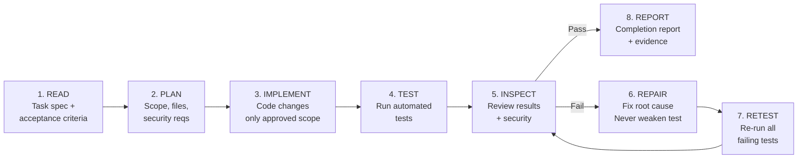

# HARNESS IMPLEMENTATION PLAN — BankingAIPlatform

**Date:** 2026-11-24  
**Status:** Proposed — pending approval  
**Reference:** Master Specification §12

---

## 1. Purpose

The Engineering Harness is a persistent control system that governs how every implementation task is planned, executed, verified, and reported across all 16 phases. It ensures:

- Consistent agent behaviour across the entire project lifecycle
- Mandatory verification for every change — no unchecked work
- Traceable evidence of all actions and decisions
- Security guardrails that cannot be bypassed or silenced
- Failed tests are never hidden — only genuinely fixed
- Phase gates enforced — no auto-progression without approval

---

## 2. Harness Directory Structure

```
D:\BANKING_AI_PLATFORM\
├── AGENTS.md                           # Agent identity, roles, behavioural rules
├── GEMINI.md                           # AI/Gemini-specific configuration and policies
│
├── engineering/
│   ├── harness/
│   │   ├── README.md                   # Harness overview and quick-start guide
│   │   ├── agent_rules.md              # Mandatory agent behavioural rules
│   │   ├── task_protocol.md            # Task lifecycle: READ→PLAN→...→REPORT
│   │   ├── verification_protocol.md    # How to verify every change
│   │   ├── repair_protocol.md          # How to fix failures (never hide tests)
│   │   ├── security_guardrails.md      # Security rules enforced in all phases
│   │   └── evidence_requirements.md    # What evidence must be recorded and where
│   │
│   ├── architecture/
│   │   ├── system_design.md            # Canonical architecture (from TARGET_ARCHITECTURE)
│   │   ├── module_boundaries.md        # Module A–J boundary definitions
│   │   ├── data_model.md               # Database schema documentation
│   │   ├── api_contracts.md            # API endpoint specifications (OpenAPI)
│   │   ├── security_model.md           # Security architecture reference
│   │   ├── agent_architecture.md       # AI agent design and permissions
│   │   └── deployment_model.md         # Docker, AWS, Azure/GCP deployment
│   │
│   ├── requirements/
│   │   ├── business_capabilities.md    # Business mode & data hub requirements
│   │   ├── functional_requirements.md  # Feature requirements by module and phase
│   │   ├── non_functional.md           # Performance, security, scalability, accessibility
│   │   └── ui_design_authority.md      # Reference to approved UI designs
│   │
│   ├── stages/
│   │   ├── phase_00_audit.md           # Phase 0 (this audit)
│   │   ├── phase_01_ui_foundation.md   # Phase 1 task definitions
│   │   ├── phase_02_core_platform.md   # Phase 2 task definitions
│   │   ├── phase_03_identity.md        # Phase 3 task definitions
│   │   ├── phase_04_business_data.md   # Phase 4 task definitions
│   │   ├── phase_05_ai_chat.md         # Phase 5 task definitions
│   │   ├── phase_06_file_upload.md     # Phase 6 task definitions
│   │   ├── phase_07_knowledge_rag.md   # Phase 7 task definitions
│   │   ├── phase_08_memory.md          # Phase 8 task definitions
│   │   ├── phase_09_tickets.md         # Phase 9 task definitions
│   │   ├── phase_10_nlp_intel.md       # Phase 10 task definitions
│   │   ├── phase_11_admin_intel.md     # Phase 11 task definitions
│   │   ├── phase_12_tools_mcp.md       # Phase 12 task definitions
│   │   ├── phase_13_enterprise.md      # Phase 13 task definitions
│   │   ├── phase_14_cloud.md           # Phase 14 task definitions
│   │   ├── phase_15_backup_dr.md       # Phase 15 task definitions
│   │   └── phase_16_production.md      # Phase 16 task definitions
│   │
│   └── evidence/
│       ├── phase_00/                   # Phase 0 audit evidence
│       ├── phase_01/                   # Phase 1 test results, scan reports
│       ├── ...                         # Per-phase evidence directories
│       └── phase_16/
│
├── tests/
│   ├── unit/                           # Unit tests (Pytest + Vitest)
│   ├── integration/                    # Integration tests
│   ├── security/                       # Security-specific tests
│   ├── e2e/                            # End-to-end tests (Playwright)
│   └── architecture/                   # Architecture conformance tests
│
├── scripts/
│   ├── setup.sh / setup.ps1            # Development environment setup
│   ├── verify.sh / verify.ps1          # Run all verification checks
│   └── security_scan.sh / .ps1         # Run all security scans
│
└── .github/
    └── workflows/
        ├── ci.yml                      # PR checks: tests, lint, security scans
        ├── security.yml                # Security scan pipeline
        └── deploy.yml                  # Deployment pipeline
```

---

## 3. Mandatory Agent Workflow (§12)



| Step | Description | Evidence Required |
|---|---|---|
| **READ** | Read task definition, acceptance criteria, related existing code | Task reference logged |
| **PLAN** | Document scope, affected files, security requirements, out-of-scope items | Plan written before any code changes |
| **IMPLEMENT** | Make approved changes only | Files created/modified listed |
| **TEST** | Run automated tests (unit, integration, security as appropriate) | Test output captured with timestamps |
| **INSPECT** | Review test results, check security implications, verify acceptance criteria | Pass/fail determination per criterion |
| **REPAIR** | Fix failures at root cause — **never delete or weaken a test** | Repair actions logged with rationale |
| **RETEST** | Re-run all previously failing tests plus regression | Test output captured |
| **REPORT** | Document results, evidence, files, next steps, known limitations | Completion report filed in evidence/ |

---

## 4. Task Definition Template

Every implementation task must specify:

```markdown
## Task: [PHASE]-[ID] — [Title]

**Phase:** [Phase number and name]
**Module:** [Module A–J or Cross-cutting]

### Scope
- What is being implemented
- What is explicitly OUT OF SCOPE

### Acceptance Criteria
- [ ] AC-1: [Testable criterion]
- [ ] AC-2: [Testable criterion]
- [ ] ...

### Expected Files
| File | Action | Description |
|---|---|---|
| `path/to/file1.py` | Create | Description |
| `path/to/file2.tsx` | Modify | Description |

### Security Requirements
- Specific security controls for this task
- Threat mitigations from SECURITY_ASSESSMENT.md

### Verification Commands
```bash
# Commands to verify this task
pytest tests/unit/test_xxx.py -v
pytest tests/security/test_xxx.py -v
semgrep --config=auto src/
```

### Dependencies
- [PHASE-ID] Task that must complete first

### Risk Classification
- [ ] LOW — read-only, no security impact
- [ ] MEDIUM — data changes, auth required
- [ ] HIGH — security-critical, requires extra review
```

---

## 5. Harness Rules Summary

### 5.1 Agent Rules (`agent_rules.md`)

1. Never begin work without reading the task definition and acceptance criteria.
2. Identify the current phase before starting any work.
3. Never claim a test passed without running it and inspecting output.
4. Never delete or weaken a failing test to make it pass.
5. Never skip security checks to save time.
6. Always record evidence of execution (stdout, screenshots, scan results).
7. Always preserve existing user work — do not delete files without authorization.
8. Do not proceed to the next major phase without explicit approval.
9. Stop and report when blocked — do not guess or fabricate results.
10. Every result labelled: VERIFIED | PARTIALLY VERIFIED | NOT VERIFIED | BLOCKED.

### 5.2 Security Guardrails (`security_guardrails.md`)

1. All user input is untrusted — validate at every boundary.
2. All LLM output is untrusted — sanitize before display or storage.
3. All file uploads are hostile until scanned and cleared.
4. No secrets in source code, logs, error messages, or git history.
5. Tenant ID must be validated and scoped on every data access.
6. Tool execution requires authorization, schema validation, and sandboxing.
7. MCP server output must be validated before use in AI context.
8. Document/image content must never override system instructions.
9. Never give AI unrestricted database access or arbitrary SQL execution.
10. Analytics Copilot uses governed, read-only query services only.

### 5.3 Evidence Requirements (`evidence_requirements.md`)

For every completed task, record:

| Evidence Type | Required | Location |
|---|---|---|
| Test execution output (stdout/stderr with timestamps) | ✅ | `engineering/evidence/phase_XX/` |
| Security scan results (tool, version, findings) | ✅ | `engineering/evidence/phase_XX/` |
| Files created or modified (path list) | ✅ | Completion report |
| Configuration changes (diff or description) | ✅ | Completion report |
| Acceptance criteria status | ✅ | Completion report |
| Verification label | ✅ | VERIFIED / PARTIALLY VERIFIED / NOT VERIFIED / BLOCKED |
| Known limitations | ✅ | Completion report |
| Screenshots (UI changes) | When applicable | `engineering/evidence/phase_XX/` |

---

## 6. Phase Completion Checklist (§14)

Every phase must pass this gate before the next phase can begin:

- [ ] Phase specification exists in `engineering/stages/`
- [ ] Scope and implementation plan documented
- [ ] All acceptance criteria defined and testable
- [ ] Implementation completed per approved scope
- [ ] Automated tests written and passing
- [ ] Security checks run and results recorded
- [ ] Regression tests passing (all prior phases)
- [ ] Documentation updated
- [ ] Evidence filed in `engineering/evidence/phase_XX/`
- [ ] Completion report produced
- [ ] Explicit approval received for next phase

---

## 7. Implementation Approach

Since no equivalent files exist in the workspace (greenfield), all harness files will be **created new** as the first task of Phase 1.

### Pre-Phase-1 Setup (Step 0)
1. Initialize git repository
2. Create `.gitignore` with comprehensive rules
3. Create harness directory structure
4. Write all harness protocol files
5. Create `.env.example` with required variables
6. Create project README.md
7. Configure pre-commit hooks (Gitleaks, Semgrep, Bandit)
8. Commit as the foundational commit

This Step 0 is a prerequisite before any feature implementation begins.
