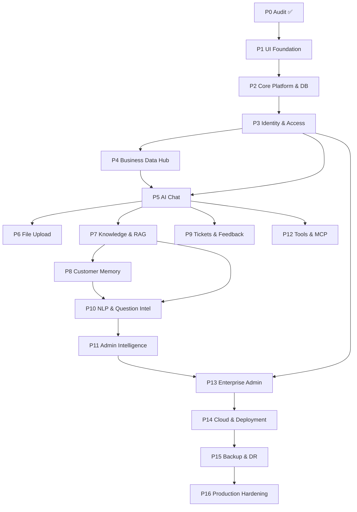

# PHASE ROADMAP — BankingAIPlatform

**Date:** 2026-11-25  
**Status:** Active — Hardening (`harden/production-readiness`)  
**Reference:** Master Specification §13

---

## 0. Phase Status Summary (`Done` / `Partial` / `Not started`)

| Phase | Status | Verified Basis |
|---|---|---|
| Phase 0 — Audit & Harness | **Done** | Harness docs & architecture baselines present. |
| Phase 1 — UI Foundation | **Done** | `npm run lint`, `tsc --noEmit`, `vitest run` (`8/8`), `vite build` pass. |
| Phase 2 — Core Platform & DB | **Partial** | SQLite async tests + Alembic `001`–`014` pass; live PostgreSQL 16 RLS (`013`) `Not started` locally (`BLOCKED` without `psql`). |
| Phase 3 — Identity & Access | **Partial** | HS256 JWT, `require_roles` RBAC (`129/129`), and tenant isolation pass; live Keycloak OIDC JWKS `Not started`. |
| Phase 4–13 — Core Modules & Enterprise | **Done** | Business Hub, AI Chat + PromptGuard, Doc Intel + ClamAV/heuristic scanner, RAG, Memory, Tickets, NLP, Analytics, Tool Gateway (4-eyes approval), Chained Audit Logs (`240+` backend tests pass). |
| Phase 14–16 — Cloud, Backup & Hardening | **Partial** | Hardened `docker-compose*.yml` + CI workflow; `trivy`/`gitleaks`/`bandit`/`semgrep` & live Docker/AWS `Not started` locally. |
| Phase 18–20 — Native Windows & Cutover | **Partial** | Deployment scripts & runbooks present; live Windows reboot & AWS staging/prod cutover `Not started`. |

---

## 1. Phase Overview

```mermaid
flowchart LR
    P0["P0\nAudit\n✅ DONE"] --> P1["P1\nUI Foundation"]
    P1 --> P2["P2\nCore Platform\n& Database"]
    P2 --> P3["P3\nIdentity &\nAccess"]
    P3 --> P4["P4\nBusiness\nData Hub"]
    P4 --> P5["P5\nAI Chat"]
    P5 --> P6["P6\nFile Upload &\nDoc Intel"]
    P6 --> P7["P7\nKnowledge\nBase & RAG"]
    P7 --> P8["P8\nCustomer\nMemory"]
    P8 --> P9["P9\nTickets &\nFeedback"]
    P9 --> P10["P10\nNLP &\nQuestion Intel"]
    P10 --> P11["P11\nAdmin\nIntelligence"]
    P11 --> P12["P12\nTools, MCP &\nWorkflow"]
    P12 --> P13["P13\nEnterprise\nAdmin"]
    P13 --> P14["P14\nCloud &\nDeployment"]
    P14 --> P15["P15\nBackup & DR"]
    P15 --> P16["P16\nProduction\nHardening"]
```

---

## 2. Phase Definitions

---

### Phase 0 — Project Audit & Harness Foundation ✅ COMPLETE

| Deliverable | Status |
|---|---|
| PROJECT_AUDIT.md | ✅ |
| CURRENT_ARCHITECTURE.md | ✅ |
| TARGET_ARCHITECTURE.md | ✅ |
| EXISTING_FEATURES_INVENTORY.md | ✅ |
| GAPS_AND_RISKS.md | ✅ |
| SECURITY_ASSESSMENT.md | ✅ |
| HARNESS_IMPLEMENTATION_PLAN.md | ✅ |
| PHASE_ROADMAP.md | ✅ (this file) |
| PHASE_0_COMPLETION_REPORT.md | ✅ |

---

### Phase 1 — UI Foundation
**Spec ref:** §11, §13  
**Goal:** Approved visual design, navigation, shared components, responsive layouts  
**Prerequisite:** UI reference images must be supplied; Docker and npm issues resolved

| Task | Description | Acceptance Criteria |
|---|---|---|
| 1.0 | Git init, harness files, pre-commit hooks | Repo initialized, harness complete, hooks working |
| 1.1 | Frontend scaffolding (React + TS + Vite + Tailwind) | Dev server starts, renders landing page |
| 1.2 | Design system setup (colours, typography, spacing) | Design tokens match approved references |
| 1.3 | Layout system (sidebar, header, content area) | Responsive layout renders correctly |
| 1.4 | Navigation and routing | All main module routes defined and navigable |
| 1.5 | Shared UI components (buttons, cards, tables, forms) | Component library renders per design |
| 1.6 | Dashboard shell pages for all modules | All module pages render with correct layout |
| 1.7 | Responsive and accessibility audit | WCAG 2.1 AA basics, mobile viewport support |
| 1.8 | Frontend tests (Vitest) | Component tests pass |

---

### Phase 2 — Core Platform & Database
**Spec ref:** §9, §10, §13  
**Goal:** Backend foundation, database models, migrations, API conventions, tenant architecture

| Task | Description | Acceptance Criteria |
|---|---|---|
| 2.1 | Backend scaffolding (FastAPI + Pydantic + SQLAlchemy) | Health endpoint returns 200 |
| 2.2 | Docker Compose (all services) | `docker-compose up` starts all containers |
| 2.3 | PostgreSQL + pgvector setup | DB accepts connections, pgvector enabled |
| 2.4 | Redis setup | Redis accepts connections |
| 2.5 | Alembic migration framework | Initial migration creates base tables |
| 2.6 | Tenant data model + RLS policies | Tenant table created, RLS policies active |
| 2.7 | Core entity models (User, Customer, Org) | Models created with tenant FK |
| 2.8 | API conventions (response envelopes, error handling, pagination) | Consistent API patterns implemented |
| 2.9 | Structured logging (JSON, correlation IDs) | Logs output structured JSON |
| 2.10 | Environment configuration (.env, validation) | Config validated on startup |
| 2.11 | Backend tests (Pytest) | Unit + DB integration tests pass |

---

### Phase 3 — Identity & Access Security
**Spec ref:** §7, §13  
**Goal:** Keycloak OIDC, registration, authentication, RBAC, tenant isolation

| Task | Description |
|---|---|
| 3.1 | Keycloak setup + realm configuration |
| 3.2 | OIDC integration (backend JWT validation) |
| 3.3 | Login / register UI flow |
| 3.4 | RBAC middleware (owner, admin, agent, customer roles) |
| 3.5 | Tenant isolation enforcement (middleware + RLS tests) |
| 3.6 | User management API (CRUD within tenant) |
| 3.7 | Session management and token refresh |
| 3.8 | API key management for integrations |
| 3.9 | Security tests: auth bypass, cross-tenant access, privilege escalation |

---

### Phase 4 — Business Setup & Data Hub
**Spec ref:** §3, §4E, §13  
**Goal:** Organization onboarding, Products/Services/Both config, data source integrations

| Task | Description |
|---|---|
| 4.1 | Organization onboarding flow |
| 4.2 | Business model selection (Products / Services / Both) |
| 4.3 | Product data model and management UI |
| 4.4 | Service data model and management UI |
| 4.5 | Google Sheets OAuth + integration |
| 4.6 | Excel / CSV upload, parse, validate |
| 4.7 | Built-in Business Data Manager (Customers, Orders, Appointments) |
| 4.8 | Data quality detection (missing, duplicates, invalid) |
| 4.9 | Data source configuration and sync scheduling |
| 4.10 | Custom fields architecture |

---

### Phase 5 — Customer Support AI Chat
**Spec ref:** §4A, §5, §13  
**Goal:** Chat system, customer identification, AI responses, escalation, handover

| Task | Description |
|---|---|
| 5.1 | Conversation data model + API |
| 5.2 | Chat UI (customer-facing) |
| 5.3 | Chat UI (agent dashboard) |
| 5.4 | WebSocket real-time messaging |
| 5.5 | Customer identification and profiles |
| 5.6 | AI agent integration (Customer Support Agent) |
| 5.7 | Intent detection and sentiment analysis |
| 5.8 | Context-aware responses using business data |
| 5.9 | Escalation to human support |
| 5.10 | Human handover and assignment |
| 5.11 | Conversation history and search |
| 5.12 | Conversation summaries |
| 5.13 | Organization-specific agent instructions |
| 5.14 | AI response evaluation |
| 5.15 | Prompt injection defence (input validation, output filtering) |

---

### Phase 6 — Customer File Upload & Document Intelligence
**Spec ref:** §4B, §13  
**Goal:** Secure uploads, scanning, OCR, image analysis, tenant-isolated storage

| Task | Description |
|---|---|
| 6.1 | Upload endpoint (JPG, JPEG, PNG, WebP, PDF) |
| 6.2 | Magic-byte + extension validation |
| 6.3 | Configurable file size limits |
| 6.4 | ClamAV integration + quarantine pipeline |
| 6.5 | Tenant-isolated object storage (MinIO/S3) |
| 6.6 | PDF text extraction (PyMuPDF) |
| 6.7 | OCR for scanned documents (Tesseract) |
| 6.8 | Image analysis (vision model) |
| 6.9 | Anti-prompt-injection for document content |
| 6.10 | Processing status tracking and error handling |
| 6.11 | Attachment previews in chat UI |
| 6.12 | Authorized download (signed URLs) |
| 6.13 | Retention and deletion policies |
| 6.14 | Celery worker setup for async processing |
| 6.15 | Security tests: malware upload, path traversal, cross-tenant access |

---

### Phase 7 — Knowledge Base & RAG
**Spec ref:** §4D, §13  
**Goal:** Document management, ingestion, embeddings, hybrid retrieval, citations

| Task | Description |
|---|---|
| 7.1 | Knowledge base data model (Documents, Versions, Chunks, Collections) |
| 7.2 | Multi-format document upload and management UI |
| 7.3 | Text extraction pipeline (PDF, DOCX, TXT, CSV, XLSX, HTML, MD) |
| 7.4 | Chunking strategies |
| 7.5 | Embedding generation + pgvector storage |
| 7.6 | Hybrid retrieval (vector + keyword) |
| 7.7 | Reranking pipeline |
| 7.8 | Source citations in AI responses |
| 7.9 | Document versioning |
| 7.10 | Collection access permissions |
| 7.11 | Knowledge freshness monitoring |
| 7.12 | Retrieval quality evaluation |
| 7.13 | RAG poisoning defence tests |

---

### Phase 8 — Customer Memory
**Spec ref:** §4C, §13  
**Goal:** Working, episodic, semantic memory with provenance and retention

| Task | Description |
|---|---|
| 8.1 | Memory data model (Working, Episodic, Semantic) |
| 8.2 | Working memory (conversation context management) |
| 8.3 | Episodic memory (past interactions, purchases, complaints) |
| 8.4 | Semantic memory (stable preferences, reusable context) |
| 8.5 | Memory retrieval integration with AI agents |
| 8.6 | Provenance tracking (source conversation/event) |
| 8.7 | Expiration and deletion policies |
| 8.8 | Anti-poisoning controls and access restrictions |
| 8.9 | Memory management UI (admin view) |

---

### Phase 9 — Complaints, Tickets & Feedback
**Spec ref:** §4F, §4G, §13  
**Goal:** Ticket lifecycle, escalation, resolution, WhatsApp/email feedback

| Task | Description |
|---|---|
| 9.1 | Ticket data model and lifecycle state machine |
| 9.2 | Auto-classification and priority assignment |
| 9.3 | Duplicate detection |
| 9.4 | Assignment, internal notes, customer communication |
| 9.5 | Escalation and resolution tracking |
| 9.6 | Ticket management UI |
| 9.7 | WhatsApp feedback delivery |
| 9.8 | Email feedback delivery |
| 9.9 | Feedback forms (rating, resolution, comments) |
| 9.10 | Consent, secure links, expiration, rate limiting |
| 9.11 | Complete audit history |

---

### Phase 10 — NLP & Question Intelligence
**Spec ref:** §4H, §13  
**Goal:** Semantic FAQ grouping, intent, sentiment, trends, knowledge gap detection

| Task | Description |
|---|---|
| 10.1 | Semantic question clustering (embeddings + topic modelling) |
| 10.2 | Canonical question identification |
| 10.3 | Similar-question grouping |
| 10.4 | Intent classification pipeline |
| 10.5 | Language detection |
| 10.6 | Sentiment analysis |
| 10.7 | Question frequency and customer count analytics |
| 10.8 | Trend analysis over time |
| 10.9 | Knowledge gap detection |
| 10.10 | Question Intelligence UI |

---

### Phase 11 — Admin Intelligence
**Spec ref:** §4I, §13  
**Goal:** Dashboards, reports, AI Insights, organizational memory, Analytics Copilot

| Task | Description |
|---|---|
| 11.1 | Dashboard framework (Recharts integration) |
| 11.2 | Customer engagement dashboard |
| 11.3 | Conversation analytics dashboard |
| 11.4 | AI performance dashboard |
| 11.5 | FAQ and complaint analytics dashboards |
| 11.6 | Knowledge Base performance dashboard |
| 11.7 | Report generation (daily/weekly/monthly/custom) |
| 11.8 | Report export (PDF, Excel, CSV) with branding |
| 11.9 | AI Insights with evidence classification |
| 11.10 | Knowledge gap dashboard |
| 11.11 | Organizational memory |
| 11.12 | Analytics Copilot (governed read-only queries) |
| 11.13 | Scheduled report generation |

---

### Phase 12 — Tools, MCP & Workflow Automation
**Spec ref:** §6, §13  
**Goal:** Tool Gateway, approved MCP integrations, tool registry, human approval

| Task | Description |
|---|---|
| 12.1 | Tool Gateway API (registration, discovery, schemas) |
| 12.2 | Internal tool implementations (search, retrieve, create) |
| 12.3 | Agent authorization for tool access |
| 12.4 | Risk classification (LOW/MEDIUM/HIGH) |
| 12.5 | Human approval gate for HIGH-risk tools |
| 12.6 | Input validation + output sanitization |
| 12.7 | Rate limiting and timeouts |
| 12.8 | MCP server integration framework |
| 12.9 | MCP output validation layer |
| 12.10 | Tool versioning and enable/disable controls |
| 12.11 | Audit logging for all tool executions |

---

### Phase 13 — Enterprise Administration
**Spec ref:** §4J, §13  
**Goal:** Organization admin, branding, users, permissions, audit, Security Center

| Task | Description |
|---|---|
| 13.1 | Organization settings and configuration |
| 13.2 | Company branding (logo, colours, consistent across UI/reports/emails) |
| 13.3 | User administration interface |
| 13.4 | Roles and permissions management |
| 13.5 | Security Center dashboard |
| 13.6 | Audit log viewer and export |
| 13.7 | Integration management UI |
| 13.8 | Model configuration |
| 13.9 | Data retention settings |
| 13.10 | System health monitoring |

---

### Phase 14 — Cloud Hosting & Deployment
**Spec ref:** §8, §13  
**Goal:** Containerized cloud deployment, AWS reference architecture, SaaS readiness

| Task | Description |
|---|---|
| 14.1 | Production Docker images (multi-stage, hardened) |
| 14.2 | AWS ECS Fargate deployment configuration |
| 14.3 | RDS PostgreSQL setup |
| 14.4 | S3 private storage configuration |
| 14.5 | CloudFront CDN for frontend |
| 14.6 | Route 53 DNS and custom domains |
| 14.7 | ALB with TLS termination |
| 14.8 | Secrets Manager integration |
| 14.9 | CloudWatch + OpenTelemetry monitoring |
| 14.10 | Cloud & Infrastructure dashboard |
| 14.11 | Horizontal scaling configuration |
| 14.12 | SaaS readiness (tenant provisioning, usage measurement) |
| 14.13 | Dedicated and private deployment templates |

---

### Phase 15 — Backup, Disaster Recovery & Business Continuity
**Spec ref:** §8, §13  
**Goal:** Automated backup, recovery, restore validation, retention, DR procedures

| Task | Description |
|---|---|
| 15.1 | Automated PostgreSQL backup (RDS snapshots or pg_dump) |
| 15.2 | Object storage backup/replication |
| 15.3 | Restore validation procedures |
| 15.4 | Backup retention policies |
| 15.5 | Disaster recovery runbook |
| 15.6 | Recovery point and time objectives (RPO/RTO) |
| 15.7 | Backup status in Cloud dashboard |

---

### Phase 16 — Production Hardening & Release
**Spec ref:** §7, §13  
**Goal:** Full security audit, performance testing, AI red-team, release evidence

| Task | Description |
|---|---|
| 16.1 | OWASP ZAP DAST scan + remediation |
| 16.2 | Trivy container + dependency scan + remediation |
| 16.3 | Garak AI vulnerability scan + remediation |
| 16.4 | Promptfoo comprehensive red-team |
| 16.5 | Playwright full E2E test suite |
| 16.6 | Performance testing + optimization |
| 16.7 | Load testing (concurrent tenants, conversations) |
| 16.8 | Checkov IaC security scan |
| 16.9 | SBOM generation (Syft) |
| 16.10 | Dependency audit (pip-audit + npm audit) |
| 16.11 | Cross-tenant isolation verification |
| 16.12 | Production deployment documentation |
| 16.13 | Release evidence package |

---

## 3. Phase Dependencies

---

## 4. Prerequisites & Blockers

| Item | Required Before | Current Status | Action Required |
|---|---|---|---|
| Docker Desktop | Phase 1 (task 2.2) | ❌ Not installed | **User must install** |
| npm execution policy fix | Phase 1 (task 1.1) | ⚠️ Blocked | **User must resolve** |
| UI reference images | Phase 1 (task 1.2) | ❌ Not found | **User must supply** |
| LLM API credentials | Phase 5 | ❌ Not present | User must supply when Phase 5 starts |
| Google OAuth credentials | Phase 4 (task 4.5) | ❌ Not present | User must supply when Phase 4 starts |
| WhatsApp API access | Phase 9 (task 9.7) | ❌ Not present | User must supply when Phase 9 starts |
| AWS credentials | Phase 14 | ❌ Not present | User must supply when Phase 14 starts |
| Cloud cost approval | Phase 14 | ❌ Not approved | User must approve before any cloud provisioning |

---

## 5. Existing Functionality Mapping

Since the workspace is greenfield (empty), there is no existing functionality to map to phases. Every capability is new construction.

| Existing Functionality | Phase Assignment |
|---|---|
| *(none — greenfield project)* | All features start in Phase 1+ |
