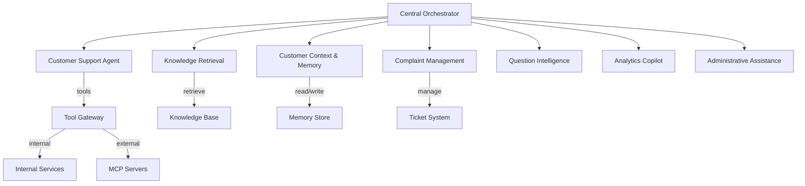
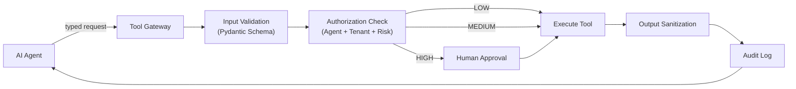
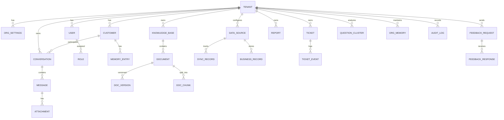

# TARGET ARCHITECTURE — BankingAIPlatform

**Date:** 2026-11-24  
**Pattern:** Modular Monolith (initial), service-extractable  
**Status:** Proposed — pending approval  
**Source:** Master Product, Architecture & Engineering Prompt §3–§10

---

## 1. Architecture Principles

1. **Modular monolith first** — single deployable with clear module boundaries; extract only when justified.
2. **Tenant isolation everywhere** — every data path scoped to tenant; RLS + application-level guards.
3. **Defense in depth** — validation at every boundary (gateway, service, storage, AI).
4. **Configuration over code** — business mode (Products / Services / Both) is runtime configuration.
5. **AI as a controlled subsystem** — agents have explicit permissions, typed I/O, execution limits, and audit trails.
6. **Evidence-driven development** — every capability backed by automated verification.
7. **Cloud-portable** — Docker Compose locally; AWS reference architecture; Azure/GCP planned.

---

## 2. High-Level System Architecture

```mermaid
flowchart TD
    subgraph Clients["Client Layer"]
        WEB["React + TypeScript + Vite + Tailwind"]
        WIDGET["Embeddable Chat Widget"]
    end

    subgraph Gateway["API Gateway Layer"]
        API["FastAPI + Pydantic v2"]
        WS["WebSocket Server"]
    end

    subgraph Modules["Application Modules (Modular Monolith)"]
        direction TB
        AUTH["Auth Module\n(Keycloak OIDC, RBAC)"]
        CHAT["Conversation Module\n(Chat, History, Escalation)"]
        AI["AI Orchestration\n(Agents, LLM, Guardrails)"]
        MEM["Memory Module\n(Working, Episodic, Semantic)"]
        KB["Knowledge Base\n(RAG, Embeddings, Retrieval)"]
        DOC["Document Pipeline\n(Upload, Scan, OCR, Extract)"]
        BDH["Business Data Hub\n(Sheets, Excel, Connectors)"]
        TKT["Ticket & Complaint\n(Lifecycle, Escalation)"]
        NLP["Question Intelligence\n(FAQ, Clustering, Sentiment)"]
        INTEL["Admin Intelligence\n(Dashboards, Reports, Copilot)"]
        TGW["Tool Gateway\n(Registry, Auth, Execution)"]
        ADMIN["Enterprise Admin\n(Tenants, Users, Branding)"]
        FB["Feedback Module\n(WhatsApp, Email)"]
    end

    subgraph Data["Data Layer"]
        PG["PostgreSQL 16+\n+ pgvector"]
        REDIS["Redis 7+\n(Cache + Broker)"]
        OBJ["MinIO / S3\n(Object Storage)"]
        CELERY["Celery Workers\n(Background Tasks)"]
    end

    subgraph External["External Services"]
        KC["Keycloak"]
        LLM["LLM Providers"]
        MCP["MCP Servers"]
        GSHEETS["Google Sheets API"]
        CRM["CRM / ERP APIs"]
        CLAM["ClamAV"]
        WA["WhatsApp API"]
        EMAIL["Email Service"]
    end

    WEB -->|HTTPS + JWT| API
    WEB -->|WSS| WS
    WIDGET -->|HTTPS + JWT| API

    API --> AUTH & CHAT & AI & MEM & KB & DOC & BDH & TKT & NLP & INTEL & TGW & ADMIN & FB
    WS --> CHAT

    AUTH -->|OIDC| KC
    AI --> LLM
    TGW --> MCP
    BDH --> GSHEETS & CRM
    DOC --> CLAM
    FB --> WA & EMAIL

    CHAT & AI & MEM & KB & DOC & BDH & TKT & NLP & INTEL & ADMIN --> PG
    CHAT & AI & DOC & CELERY --> REDIS
    DOC --> OBJ
    REDIS --> CELERY
```



---

## 3. Technology Stack

| Layer | Technology | Version | Justification |
|---|---|---|---|
| Frontend | React, TypeScript, Vite, Tailwind CSS, Recharts | React 18+, TS 5+ | Modern, performant, wide ecosystem |
| Backend | Python, FastAPI, Pydantic v2, SQLAlchemy 2.0, Alembic | Python 3.12+ | Async, typed, excellent for AI workloads |
| Database | PostgreSQL + pgvector | PG 16+ | Relational + vector search in one engine |
| Cache / Broker | Redis | 7+ | Pub/sub, caching, Celery broker |
| Task Queue | Celery | 5+ | Distributed task processing with retries |
| Auth | Keycloak | 24+ | OIDC, RBAC, multi-tenant, SSO |
| AI Runtime | Controlled agent orchestration (LangGraph or custom) | — | Sandboxed tool use, guardrails, audit |
| Object Storage | MinIO (dev) / S3 (prod) | — | Tenant-isolated file storage |
| Malware Scan | ClamAV | — | Open-source, container-ready |
| OCR | Tesseract / Cloud Vision API | — | PDF and image text extraction |
| Monitoring | OpenTelemetry, Prometheus, Grafana | — | Observability stack |
| Testing | Pytest, Vitest, Playwright, Promptfoo, Garak | — | Full test pyramid + AI red-team |
| Deployment | Docker, Docker Compose | — | Local dev; ECS Fargate for cloud |

---

## 4. Module Architecture Detail

### Module A — AI Customer Support
- Conversational AI chat with customer identification
- Multi-turn context management and conversation history
- Intent detection, sentiment analysis, multilingual architecture
- Context-aware responses using KB + business data
- Escalation to human support with handover protocol
- AI response evaluation and configurable agent behaviour
- Organization-specific instructions and policies

### Module B — File Upload & Document Intelligence
- Secure upload endpoint: JPG, JPEG, PNG, WebP, PDF (extensible to DOCX)
- Magic-byte + extension validation, configurable size limits
- ClamAV malware scan → quarantine → clean pipeline
- Tenant-isolated object storage with signed download URLs
- Celery workers: PDF extraction (PyMuPDF), OCR (Tesseract), image analysis (vision model)
- Processing status tracking, error records, audit trail
- Retention and deletion policies per tenant
- Anti-prompt-injection for document/image content

### Module C — Customer Memory
- **Working memory**: current conversation context, short-term state
- **Episodic memory**: past interactions, complaints, purchases, resolutions
- **Semantic memory**: stable preferences, reusable context
- Retrieval, update, provenance, expiration, deletion policies
- Anti-poisoning: source validation, access control, integrity checks

### Module D — Knowledge Base & RAG
- Multi-format ingestion: PDF, DOCX, TXT, CSV, XLSX, HTML, Markdown, FAQ, web
- Document versioning, collections, categories, access permissions
- Text extraction → chunking → embeddings → pgvector storage
- Hybrid retrieval (vector + keyword) with reranking
- Source citations in AI responses
- Retrieval quality evaluation and freshness monitoring
- Knowledge gap identification

### Module E — Business Data Hub
- **Google Sheets**: OAuth, sheet/worksheet selection, column mapping, AI-assisted mapping, sync scheduling, error handling, read-only default
- **Excel / CSV**: Upload, parse, validate, store
- **Built-in CRUD**: Customers, Products, Services, Orders, Appointments, Categories
- **Database connectors**: PostgreSQL and other approved databases (read-only)
- **API connectors**: REST, CRM, ERP with OAuth2/API-key auth
- Data quality: missing values, duplicates, invalid formats, freshness indicators
- External sources augment but do not replace internal PostgreSQL

### Module F — Complaints & Ticket Management
- Lifecycle: New → Categorized → Assigned → In Progress → Waiting → Escalated → Resolved → Closed
- Auto-classification, priority assignment, duplicate detection
- Human assignment, internal notes, customer communication
- Resolution tracking, reopening, complete audit history

### Module G — Customer Feedback
- Two delivery channels: WhatsApp message, Email
- Form: satisfaction rating, resolution status (Yes/Partially/No), agent rating, comments
- Consent, secure links, expiration, rate limiting, delivery tracking

### Module H — NLP & Question Intelligence
- Semantic FAQ clustering using embeddings + topic modelling
- Canonical question identification, similar-question grouping
- Intent classification, language detection, sentiment analysis
- Frequency, unique customer counts, trends, escalation statistics
- Answer quality tracking, knowledge-source identification

### Module I — Admin Intelligence
- Dashboards: engagement, conversations, AI performance, FAQ, complaints, KB, business data, feedback
- Reports: daily/weekly/monthly/custom with PDF/Excel/CSV export
- Branded reports with organization logo
- AI Insights with evidence classification (verified/measured/hypothesis/recommendation)
- Knowledge gap dashboard
- Analytics Copilot: conversational interface with governed read-only queries

### Module J — Enterprise Administration
- Organization settings, company name, branding, logo management
- User administration, roles, permissions (RBAC)
- Security Center, audit logs
- Integration management, model configuration
- Data retention settings, backup and recovery
- Cloud and infrastructure administration, health monitoring

---

## 5. AI Agent Architecture (§5)



Agent constraints:
- Explicit instructions per agent
- Defined permissions and tool access (whitelist only)
- Typed inputs/outputs (Pydantic schemas)
- Execution limits (tokens, time, retries)
- Audit records for every invocation
- Failure handling and human approval gates
- No arbitrary SQL, no raw DB access, no OS commands

---

## 6. Tool Gateway Architecture (§6)



Risk classification:
- **LOW**: approved read-only actions
- **MEDIUM**: controlled business-data changes
- **HIGH**: sensitive, destructive, financial, or privileged operations → human approval

---

## 7. Multi-Tenant Data Architecture (§10)

### 7.1 Core Schema



### 7.2 Key Entities (from §10)

| Category | Entities |
|---|---|
| Core | Tenants, Organization Settings, Branding |
| Identity | Users, Roles, Permissions |
| Customers | Customers, Customer Memories, Memory Sources |
| Conversations | Conversations, Messages, Summaries, Attachments |
| Knowledge | Documents, Document Versions, Chunks, Collections, Embeddings |
| Business Data | Products, Services, Orders, Appointments, Data Sources, Connectors, Sync Records |
| Tickets | Tickets, Ticket Events, Feedback Requests, Feedback Responses |
| Intelligence | Question Clusters, Analytics Insights, Evidence Records, Reports, Report Schedules |
| Operations | Audit Logs, Security Events, Backups, Deployment Metrics |
| Memory | Working Memory, Episodic Memory, Semantic Memory (per customer per tenant) |

### 7.3 Isolation Strategy
- PostgreSQL Row-Level Security (RLS) policies on all tenant-scoped tables
- Application-level tenant context injection via middleware
- Object storage: tenant-prefixed bucket paths or separate buckets
- Vector embeddings: tenant-scoped namespaces in pgvector
- Frontend: never trusted as a security boundary

---

## 8. Deployment Architecture (§8)

### 8.1 Development Environment (Docker Compose)

```
docker-compose.yml
├── frontend         (React + Vite dev server)
├── backend          (FastAPI + Uvicorn)
├── postgres         (PostgreSQL 16 + pgvector)
├── redis            (Redis 7)
├── keycloak         (Identity provider)
├── minio            (S3-compatible object storage)
├── celery-worker    (Background task processing)
├── celery-beat      (Scheduled tasks)
├── clamav           (Malware scanning)
└── grafana/prom     (Monitoring — optional in dev)
```

### 8.2 Cloud Reference Architecture (AWS)

| AWS Service | BankingAIPlatform Component |
|---|---|
| ECS Fargate | Backend containers, Celery workers |
| RDS PostgreSQL | Primary database with pgvector |
| ElastiCache Redis | Caching and task broker |
| S3 | Private file storage (per-tenant) |
| ECR | Container registry |
| CloudFront | CDN for frontend assets |
| Route 53 | DNS and custom domains |
| Secrets Manager | Credentials and API keys |
| CloudWatch + OTEL | Monitoring and alerting |
| ALB | Load balancing with TLS |

### 8.3 Deployment Models

| Model | Description | Isolation |
|---|---|---|
| **A — SaaS** | Multi-tenant, shared infrastructure | RLS + app-level |
| **B — Dedicated** | Single customer, separate deployment | Infrastructure-level |
| **C — Private** | Customer's own cloud/infra | Full |

---

## 9. API Design

- Versioned: `/api/v1/`
- RESTful with consistent response envelopes
- Pydantic v2 request/response models
- JWT authentication on all protected endpoints
- Tenant context extracted from token claims
- Rate limiting per tenant
- WebSocket for real-time chat delivery
- OpenAPI documentation auto-generated
