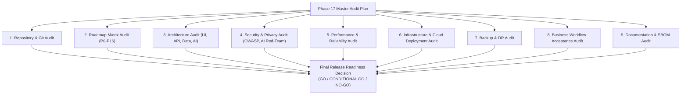

# Phase 17 — Audit Plan & Master Execution Strategy

## 1. Executive Mission & Objectives
**Project:** BankingAIPlatform — Enterprise AI Customer Support & Business Intelligence Platform  
**Phase:** Phase 17 — Final Release Acceptance & Operational Readiness  
**Objective:** Perform a rigorous, independent, evidence-based final release audit across the entire codebase, architecture, security posture, infrastructure, disaster recovery, and documentation to establish a defensible **GO / CONDITIONAL GO / NO-GO** production release decision.

---

## 2. Methodology & Evidence Governance
The audit adheres strictly to the BankingAIPlatform Harness Engineering protocols:
```
READ → PLAN → INSPECT → REPORT
```

### Evidence Classifications
Every finding, check, and workflow is explicitly classified into one of five rigorous tiers:
- **`VERIFIED`**: Directly inspected and proven by automated test execution or code inspection with recorded terminal evidence.
- **`PARTIALLY VERIFIED`**: Inspected and functional, with minor non-blocking external dependencies or documentation caveats.
- **`NOT VERIFIED`**: Implementation or documentation exists, but operational execution evidence is incomplete or absent.
- **`BLOCKED`**: Execution requires external cloud credentials, paid infrastructure, or live third-party connectivity (e.g. AWS live provisioning, WhatsApp API).
- **`FAILED`**: Explicitly executed and failed assertion or requirement.

---

## 3. Strict Safety & Operational Boundaries (Stage A)
In accordance with user directives, Stage A is strictly a **read-only audit**:
- **Zero code changes:** No modifications to application code or tests.
- **Zero infrastructure mutations:** No deployment to AWS, Azure, GCP, or local Docker daemons.
- **Zero credential leaks:** No printing, logging, or exposing API secrets or keys.
- **Zero destructive actions:** No schema drops, data wipes, or database mutations.

---

## 4. Audit Workstreams



1. **Repository & Git Audit:** Branch validation, commit integrity, working-tree purity, tooling compatibility.
2. **Roadmap Matrix Audit:** Verification of all 16 preceding phases against specifications, code, tests, evidence, and completion reports.
3. **Architecture Audit:** Full review of frontend (React/Vite), backend (FastAPI/Pydantic/SQLAlchemy/Alembic), multi-tenant data boundaries, and AI system safety.
4. **Security & Privacy Audit:** Evaluation of threats T-01 through T-18, OWASP API Top 10, Garak/Promptfoo AI red-teaming, Checkov IaC scans, dependency CVEs.
5. **Performance & Reliability Audit:** Latency benchmarks, 20-worker burst concurrency, SQLite in-memory test harness vs production PostgreSQL.
6. **Infrastructure & Deployment Audit:** Production Dockerfiles, Nginx security configuration, Docker Compose, Terraform AWS reference architecture.
7. **Disaster Recovery Audit:** PostgreSQL backups, S3 replication, restore validation drills, GFS retention, disaster recovery runbook.
8. **Business Workflow Acceptance:** Validation of Customer, Support Agent, Org Admin, and Platform Admin personas.
9. **Documentation & Release Governance:** Inspection of operations guides, SBOM, lockfiles, and release notes.

---

## 5. Audit Deliverables Schedule
All Stage A audit artifacts are authored under `engineering/release/phase_17/`:
- `PHASE_17_AUDIT_PLAN.md` (This document)
- `PHASE_17_REPOSITORY_AUDIT.md`
- `PHASE_17_ROADMAP_VERIFICATION.md`
- `PHASE_17_ARCHITECTURE_AUDIT.md`
- `PHASE_17_SECURITY_AUDIT.md`
- `PHASE_17_PERFORMANCE_AUDIT.md`
- `PHASE_17_INFRASTRUCTURE_AUDIT.md`
- `PHASE_17_DISASTER_RECOVERY_AUDIT.md`
- `PHASE_17_BUSINESS_ACCEPTANCE_AUDIT.md`
- `PHASE_17_DOCUMENTATION_AUDIT.md`
- `PHASE_17_REMEDIATION_REGISTER.md`
- `PHASE_17_FINAL_RELEASE_READINESS_REPORT.md`
- Raw execution evidence recorded in `engineering/evidence/phase_17/task_17_stage_a_evidence.md`.
