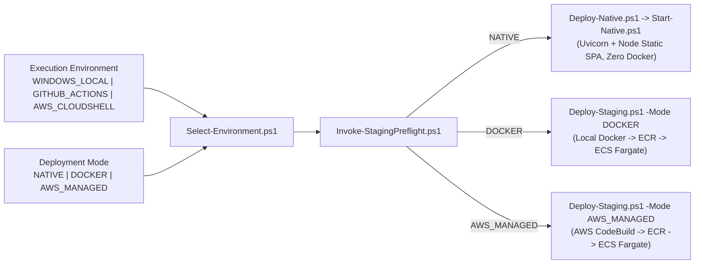

# Phase 18.2 — Optional Docker & Multi-Mode Deployment Architecture

## 1. Core Architectural Principle
**Docker is an optional deployment technology, not a platform requirement.**  
BankingAIPlatform cleanly separates **Execution Environment** (`WINDOWS_LOCAL`, `GITHUB_ACTIONS`, `AWS_CLOUDSHELL`) from **Deployment Mode** (`NATIVE`, `DOCKER`, `AWS_MANAGED`).

---

## 2. Supported Deployment Modes

### Mode 1: `NATIVE` (Default for `WINDOWS_LOCAL`)
Docker-free local production execution on Windows:
- **Backend:** Uses Python 3.12 virtual environment (with safe fallback to system Python under Windows AppLocker), installs pinned `backend/requirements.txt`, executes `alembic upgrade head` (when `DATABASE_URL` is configured), and runs FastAPI via **Uvicorn** (`--host 127.0.0.1 --port 8000`, without `--reload`).
- **Frontend:** Builds production assets (`npm run build` -> `frontend/dist/`) and serves them via `scripts/deploy/serve_frontend.mjs` (a zero-dependency production HTTP server with CSP, `X-Frame-Options`, `X-Content-Type-Options`, SPA routing fallback, and `/healthz`).
- **Lifecycle Scripts:**
  - `scripts/deploy/Deploy-Native.ps1`
  - `scripts/deploy/Start-Native.ps1`
  - `scripts/deploy/Stop-Native.ps1`
  - `scripts/deploy/Test-Native.ps1`

### Mode 2: `DOCKER`
Preserves the existing hardened multi-stage container workflow (`backend/Dockerfile.prod` and `frontend/Dockerfile.prod`):
- Builds images locally via Docker Desktop / Docker Engine.
- Pushes immutable tags to Amazon ECR and triggers ECS Fargate rolling deployments.

### Mode 3: `AWS_MANAGED` (Cloud Deployment Without Local Docker)
Evaluated AWS managed hosting options for BankingAIPlatform's multi-service architecture (FastAPI + Celery Workers + ClamAV + PostgreSQL 16 + Redis 7):

| AWS Service Evaluated | Suitability for BankingAIPlatform | Assessment |
| :--- | :---: | :--- |
| **AWS App Runner** | Partial | Suitable for single-container stateless web APIs, but lacks native orchestration for BankingAIPlatform's multi-container background workers (Celery + ClamAV) sharing a VPC with private RDS and ElastiCache Redis 7 TLS. |
| **AWS CodeBuild + ECS Fargate + S3/CloudFront** | **Optimal (Selected)** | `buildspec.yml` builds `backend/Dockerfile.prod` and `frontend/Dockerfile.prod` remotely in AWS CodeBuild, pushes to ECR, and deploys onto the exact existing Terraform ECS Fargate VPC stack — **zero local Docker required on Windows**. |
| **AWS Amplify / S3 + CloudFront** | Optimal (Frontend) | Serves static `frontend/dist/` bundle globally with TLS 1.3 and CDN caching. |

---

## 3. Environment & Mode Matrix Examples

| Execution Environment | Deployment Mode | Example Command |
| :--- | :--- | :--- |
| `WINDOWS_LOCAL` | `NATIVE` *(default)* | `.\scripts\deploy\Deploy-Staging.ps1` |
| `WINDOWS_LOCAL` | `DOCKER` | `.\scripts\deploy\Deploy-Staging.ps1 -Mode DOCKER -ConfirmProvisioning` |
| `WINDOWS_LOCAL` | `AWS_MANAGED` | `.\scripts\deploy\Deploy-Staging.ps1 -Mode AWS_MANAGED -ConfirmProvisioning` |
| `GITHUB_ACTIONS` | `DOCKER` / `AWS_MANAGED` | `.github/workflows/staging-deploy.yml` (`workflow_dispatch`) |
| `AWS_CLOUDSHELL` | `AWS_MANAGED` | `export BANKING_AI_DEPLOY_ENV=AWS_CLOUDSHELL; export BANKING_AI_DEPLOY_MODE=AWS_MANAGED` |

---

## 4. Shared Infrastructure Invariants
Across **all** modes, BankingAIPlatform preserves the exact same managed infrastructure and security posture:
- PostgreSQL 16 + `pgvector` & native RLS (`scripts/deploy/verify_rls_postgres.sql`)
- Redis 7 with TLS
- S3 private tenant storage (SSE + public access block)
- AWS Secrets Manager (zero hardcoded credentials)
- HTTPS/TLS 1.3 & CloudWatch monitoring
