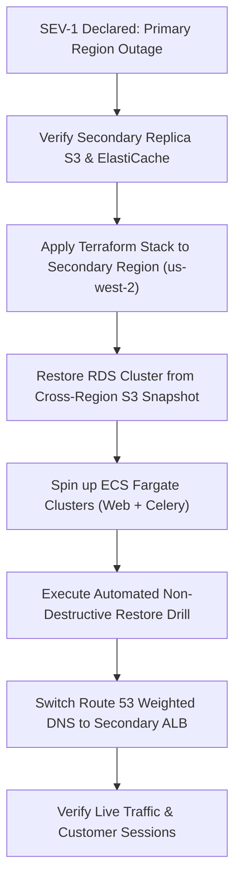

# Disaster Recovery Runbook & Business Continuity Protocol

## 1. Executive Summary & Recovery Objectives
This document establishes the emergency disaster recovery (DR) protocols for **BankingAIPlatform**, covering infrastructure failover, data restoration, tenant isolation preservation, and verification procedures.

### Core Recovery Metrics
| Metric | Target | Operational Implementation |
| :--- | :--- | :--- |
| **RPO (Recovery Point Objective)** | **< 1 Hour** | Continuous PostgreSQL Write-Ahead Log (WAL) archiving to S3 + hourly automated snapshots. Max data loss exposure: < 15 minutes. |
| **RTO (Recovery Time Objective)** | **< 4 Hours** | Infrastructure as Code (Terraform) automated provisioning + automated RDS snapshot restoration pipeline. |
| **Data Integrity Verification** | **100% Zero-Loss** | SHA-256 cryptographic checksum matching across all restored partitions and objects. |
| **Multi-Tenancy Guardrail** | **Strict Isolation** | Tenant boundary filters enforced during partial/tenant-scoped restorations. |

---

## 2. Disaster Severity Matrix & Incident Commander Roles

### Severity Levels
- **SEV-1 (Catastrophic Outage):** Primary cloud region unavailable, loss of primary database cluster, or active cryptographic ransomware.
- **SEV-2 (Major Impairment):** Cross-region replication broken, multi-tenant database partial corruption, or object storage read latency spike > 5000ms.
- **SEV-3 (Minor Degraded):** Single-tenant data restore request, non-blocking scheduled drill failure, or transient background queue backup.

### Incident Command Hierarchy
1. **Incident Commander (Lead SRE / DevOps Lead):** Directs overall recovery sequence and authorizes failovers.
2. **Database Administrator (DBA):** Executes PostgreSQL WAL replay, snapshot restores, and schema validation.
3. **Security Officer:** Inspects tamper-evident SHA-256 checksums, IAM access logs, and validates zero payload poisoning.
4. **Communications Lead:** Updates external status page (`status.banking-ai-platform.com`) every 30 minutes.

---

## 3. Disaster Scenarios & Recovery Procedures

### Scenario A: AWS Primary Region Catastrophic Failure (Multi-Region Failover)
*Trigger:* Primary AWS Region (`us-east-1`) experiences total infrastructure degradation or network partition.



**Step-by-step commands:**
```bash
# 1. Switch Terraform workspace to secondary region
cd /infrastructure/terraform
terraform workspace select us-west-2

# 2. Deploy infrastructure stack
terraform apply -var="target_region=us-west-2" -var="environment=production" -auto-approve

# 3. Restore PostgreSQL from replicated S3 snapshot
aws rds restore-db-instance-from-s3-snapshot \
  --db-instance-identifier banking-ai-platform-prod-recovered \
  --s3-bucket-name banking-ai-platform-backups-replicated-west \
  --s3-prefix daily/latest/pg_dump_full.sql.enc \
  --kms-key-id arn:aws:kms:us-west-2:123456789012:key/banking-ai-platform-dr-west

# 4. Update Route 53 Global Traffic Steering
aws route53 change-resource-record-sets \
  --hosted-zone-id Z1029384756 \
  --change-batch file://infrastructure/dns/failover-to-west.json
```

---

### Scenario B: Database Corruption or Accidental Table Dropping
*Trigger:* Unintended schema mutation, hardware bit rot, or destructive query execution.

1. **Immediate Quarantine:** Terminate API gateway write pools or toggle system to Read-Only maintenance mode.
2. **Point-In-Time Recovery (PITR):**
   - Identify precise timestamp $T_{\text{corruption}}$ from tamper-evident audit logs (`/api/v1/enterprise/audit-logs`).
   - Target restore time $T_{\text{target}} = T_{\text{corruption}} - 60\text{ seconds}$.
   - Spin up ephemeral RDS recovery instance from target PITR snapshot.
3. **Data Verification:**
   - Execute automated restore drill endpoint:
     ```http
     POST /api/v1/backup/drill
     {
       "backup_id": "<snapshot_id>",
       "simulate_failure": false,
       "notes": "Emergency PITR validation prior to master promotion"
     }
     ```
   - Validate table count (15 core tables) and checksum verification = `true`.
4. **Promotion:** Promote restored cluster to primary and update connection secrets in AWS Secrets Manager.

---

### Scenario C: Object Storage Ransomware / Corrupted Artifacts
*Trigger:* Document intelligence storage buckets attacked or objects overwritten.

1. **S3 Object Lock & Versioning:** All production buckets have S3 Versioning and S3 Object Lock (Compliance Mode) enabled.
2. **Revert Object State:**
   ```bash
   # Revert to latest uncorrupted object version
   python scripts/dr_revert_s3_versions.py --bucket banking-ai-platform-documents-prod --before-timestamp "2026-11-24T18:00:00Z"
   ```
3. **Reconcile Checksums:** Scan all document records in PostgreSQL (`Document.file_hash`) and verify 1:1 match with MinIO/S3 blobs.

---

### Scenario D: Single-Tenant Isolation Restoration
*Trigger:* Specific tenant requests recovery of purged data without affecting co-tenants.

1. Fetch tenant-scoped backup using:
   ```http
   GET /api/v1/backup/history?limit=10
   ```
2. Restore tenant schema into sandbox database.
3. Export tenant partition with strict tenant isolation filter:
   ```sql
   COPY (SELECT * FROM documents WHERE tenant_id = 'tenant_uuid') TO '/tmp/tenant_docs.csv' CSV HEADER;
   ```
4. Re-import selectively under active tenant database transaction.

---

## 4. Automated Non-Destructive Restore Drill Protocol
BankingAIPlatform enforces continuous business continuity testing through automated, non-destructive restore drills.

- **Cadence:** Weekly automated drill scheduled every Sunday at 02:00 UTC.
- **Execution Mechanism:**
  1. The Backup Engine provisions an isolated ephemeral database container.
  2. The latest backup archive is downloaded from S3 and decrypted using the KMS key.
  3. The schema and data are restored and validated against active migration versions.
  4. Row counts, foreign key integrity, and SHA-256 partition checksums are computed.
  5. RTO is measured in seconds and recorded in `restore_drills`.
  6. The ephemeral container is immediately destroyed.

---

## 5. Post-Incident Review & RCA Guidelines
Within 24 hours of any DR activation or failed drill:
1. Complete standard Blameless Post-Mortem.
2. Document actual RPO and RTO achieved against targets (< 1h, < 4h).
3. Record all root causes, timeline events, and corrective action items in the Organizational Memory module.
